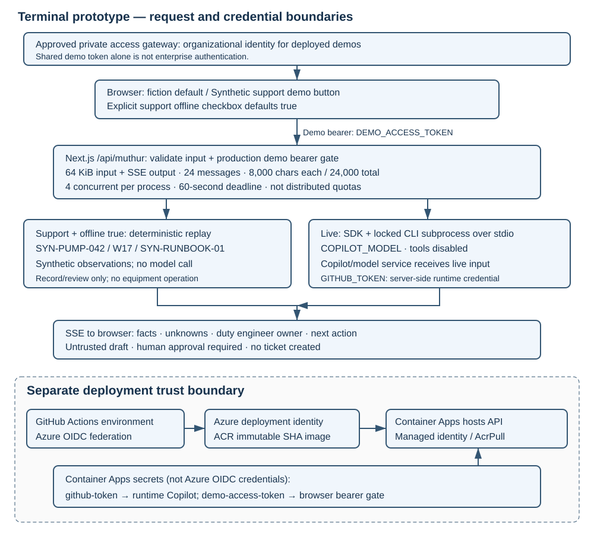
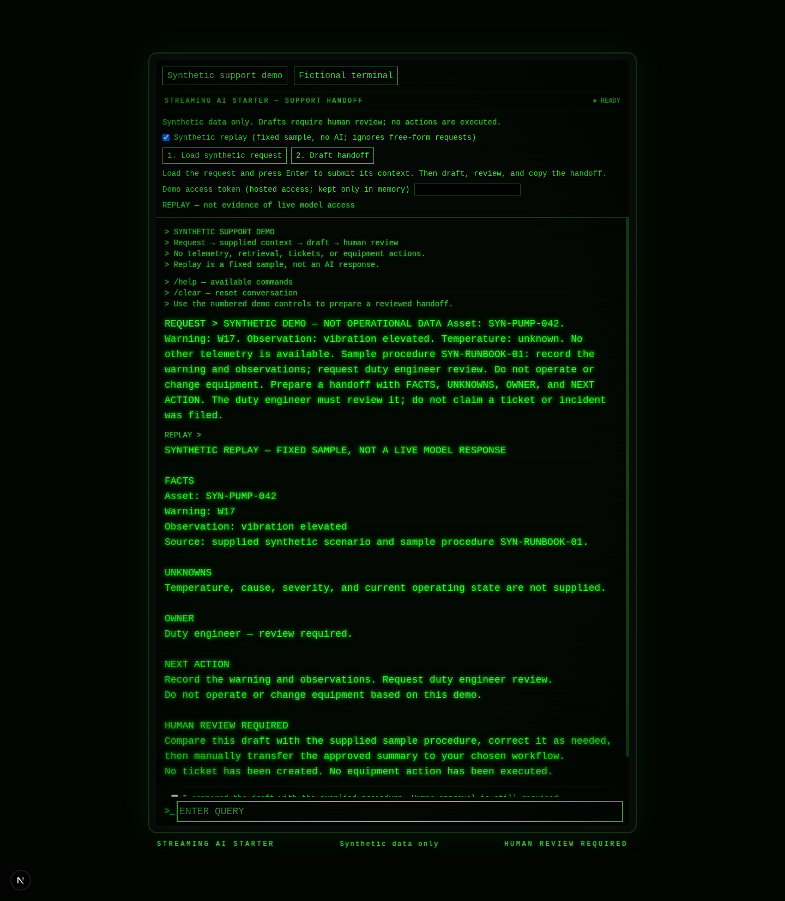

```text
+------------------------------------------------------------+
|  M U T H U R   /   T E R M I N A L                           |
|  > CONNECT   > STREAM   > REVIEW                            |
|  AI EXPERIENCE STARTER                      [ PROTOTYPE _ ] |
+------------------------------------------------------------+
             \__________________________________/
              /________________________________\
```

# MUTHUR Terminal — Streaming AI Experience Starter

An **AI application development accelerator** for developers and platform
engineers building reusable streaming experiences with Next.js and the GitHub
Copilot SDK. Solution engineers, CSAs, and product owners can use the same starter
to explore cross-industry scenarios. Its original *Alien*-inspired fiction remains
the default; a neutral synthetic support scenario demonstrates evidence-bounded,
human-reviewed handoffs—not a support triage product. It does **not** diagnose
equipment, operate tools, or create tickets.

**Readiness: prototype; external distribution and catalog submission pending
verification.** No customer deployment, authenticated model access, Azure rollout,
or business outcome is claimed. Rights, branding, and owner approval remain blockers.

## Try it in five minutes

Prerequisites: Node.js 22.12+ (24 recommended), npm, and network access for dependency
installation. The system Courier/monospace font needs no remote font fetch at build.
Offline replay does not need
Copilot credentials; `npm ci` installs the pinned CLI for live mode. Live use needs
CLI authentication, eligible Copilot access, and access to the selected model.

```bash
npm ci
npm run dev
```

Open [localhost:3000](http://localhost:3000), then select **Synthetic support demo**
in the browser. The default fiction boot remains unchanged; there is no
query-string selection. Leave **offline replay checked** (the default). Use
**1. Load synthetic request**, **press Enter to submit the loaded request**,
then **2. Draft handoff**. Inspect the draft and acknowledge the human-review
checkbox to enable **3. Copy for human review**.
For a typed prompt:

> Summarize SYN-PUMP-042 warning W17 and prepare a duty engineer handoff.

This is an **explicit deterministic replay**, not a live model result. The shared
synthetic fixture has elevated vibration and unknown temperature. Its only
procedure, SYN-RUNBOOK-01, permits recording the warning/observations and requesting
duty engineer review—not operating or changing equipment.

Expected output: facts, unknowns, owner (duty engineer), next action, and human
approval requirement. No ticket is created. Use [the demo guide](docs/demo.txt)
for a timed five- or fifteen-minute presentation and recovery steps.

## Live mode and validation

After `npm ci`, authenticate locally with `npx --no-install copilot auth login`,
then uncheck offline replay in
support mode. `COPILOT_MODEL` defaults to `claude-sonnet-4-5`; entitlement and model
availability must be checked in your environment. Fiction queries use live mode.
Never put GitHub credentials in the browser.

For a production process, set `DEMO_ACCESS_TOKEN` to a private random value of at
least 32 characters. Enter that shared token in the browser password field; it is
sent as a bearer credential and is not persisted in the browser. This is a demo
gate, **not enterprise authentication**.
Put deployed demonstrations behind an approved private access gateway as well.

```bash
npm run lint
npm run build
```

No test framework is configured. `.github/workflows/validate.yml` runs PR lint/build
and supplies the reusable deployment gate.
[Setup and troubleshooting](docs/setup.txt) covers Docker, configuration, and
manual acceptance checks; [security](docs/security.txt) covers limits and data.

## Developer story and cross-industry reuse

You need to turn an AI interaction idea into a demonstrable application without
confusing model output, offline fixtures, operational actions, and human decisions.
This starter exposes those boundaries through a reusable streaming UI, server-side
SDK integration, deterministic replay, and an explicit review handoff. Evaluate the
pattern for your industry only after replacing the evidence and approval policy
with domain-owner-approved material.

In the included demo, a support coordinator receives a synthetic pump warning and needs a concise,
evidence-bounded handoff, not an autonomous repair. The demo separates known
observations from missing evidence and routes the decision to a duty engineer.
Success means a reviewer can identify the evidence, uncertainty, accountable
owner, and approval gate without assuming an action or ticket occurred.

Reuse the streaming UI and bounded handoff pattern for an approved support
scenario; replace the fixture, approved procedure, prompt, branding, and access
controls together. There is no retrieval integration, equipment connection,
ticketing integration, or measured productivity claim.

## Self-serve guide

| Need | Guide |
| --- | --- |
| Rehearse a customer journey, demo, or engagement | [Demo and engagement](docs/demo.txt) |
| Install, configure, validate, or recover | [Setup](docs/setup.txt) |
| Provision, deploy, roll back, and clean up Azure | [Deployment](docs/deployment.txt) |
| Review data boundaries and report vulnerabilities | [Security](docs/security.txt) |
| Customize or request support | [Customization and support](docs/support.txt) |
| Assess blockers and independent handoff | [Readiness checklist](docs/readiness.txt) |
| Inspect draft catalog metadata | [accelerator.yaml](accelerator.yaml) |

## Architecture



[Editable Mermaid source](docs/architecture.mmd). Browser → Next.js API → either
deterministic support replay or a tool-disabled Copilot SDK session → SSE response.
Azure OIDC deploy credentials, server-side Copilot credentials, and the browser
demo bearer are separate trust boundaries. Request safeguards are process-local,
not a distributed quota.

Stack: Next.js 16.4.2 App Router, React, Tailwind CSS v4, system Courier/monospace,
`@github/copilot-sdk` 1.0.22, and Copilot CLI 1.0.98 (matching the SDK's declared
CLI version). The server uses standalone output. Docker uses `node:24-bookworm-slim`
for glibc compatibility and copies lockfile-installed `@github` native SDK/platform
libraries and CLI packages with its `.bin` launcher, rather than installing a
global unpinned CLI. The API explicitly uses `RuntimeConnection.forStdio` to run
the CLI transport; native SDK/platform libraries are also packaged.
The API explicitly resolves the locked local `@github/copilot/npm-loader.js`
through `createRequire` and launches the CLI as a Node subprocess over stdio, not
an in-process native runtime. It does not rely on a
system CLI or the SDK's default runtime download. A separate global CLI installation
is not required.
The runtime-only audit reports zero findings; the full development audit still
has 26 findings requiring review, so this is not an overall clean security claim.
Azure Container Apps is the only documented/supported cloud path;
the legacy App Service workflow is not the recommended deployment.

## Fixed synthetic replay walkthrough

These real local captures illustrate **offline replay**, not evidence of
authenticated live or cloud validation. Independent media review remains open.



| Entry | Commands | Handoff | Recovery |
| --- | --- | --- | --- |
| [Support entry](docs/assets/hero.png) | [Command discovery](docs/assets/commands.png) | [Synthetic journey](docs/assets/journey.png) | [Recovery](docs/assets/recovery.png) |

[Five-minute edited, captioned screenshot walkthrough](docs/assets/demo.mp4) ·
[Captions](docs/assets/demo.vtt) · [Transcript](docs/assets/transcript.txt).
The video is silent with held frames from actual UI captures, **not a continuous
screen recording**. [Mobile capture](docs/assets/mobile.png). These are local
synthetic replay evidence, not model or cloud verification.

## Rights and support

Do not assume a repository license or rights to redistribute franchise names,
logos, dialogue, or imagery. The neutral demo does not remove franchise material
elsewhere in the repository. Obtain rights/branding review and owner approval
before external use. Support owner: **TBD**; no SLA or production support promise.
See [support](docs/support.txt) and [readiness](docs/readiness.txt).
